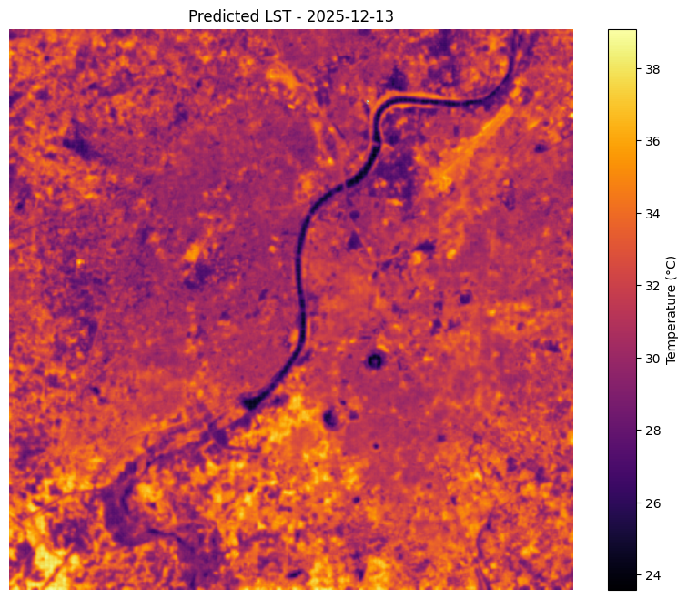
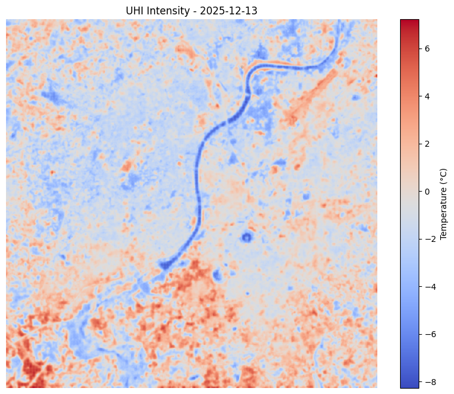
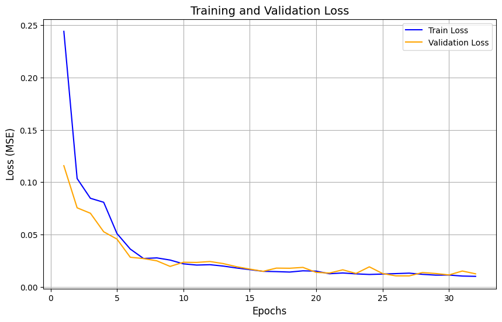
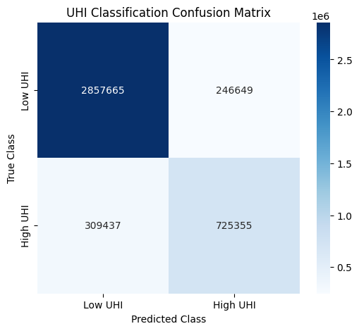
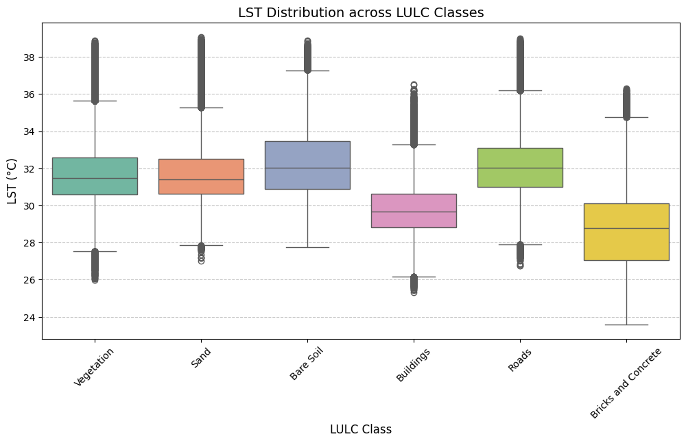

# SwinGeo: Hierarchical Shifted-Window Transformer for High-Resolution Urban Heat Island (UHI) Mapping

[](https://github.com/Sreekar-2612/LAND_SURFACE_TEMPERATURE_PREDICTION_USING_TRANSFORMERS)
[](https://www.python.org/downloads/)
[](https://pytorch.org/)
[](LICENSE)

> [!WARNING]
> ### 🚧 Project Status: Active Research & Development
> This repository is under active scientific development. Code, architectures, and pipeline modules are frequently updated. Current development priorities include:
> 1. Mitigating temporal domain shift across seasons via thermodynamic conditioning (incorporating continuous ERA5 2m air temperature and solar elevation).
> 2. Full native Sentinel-2 Level-2A multi-spectral optical band fusion (10 m native resolution).
> 3. Expansion of multi-seasonal training datasets across peak summer (May/June) and winter (December/January).

---

## 🌍 About The Project

Rapid global urbanization has intensified the **Urban Heat Island (UHI)** phenomenon, where built environments experience significantly higher temperatures than surrounding peri-urban and rural areas. High surface temperatures degrade urban air quality, escalate building cooling energy demands, and present severe thermal stress hazards to vulnerable populations.

### The Downscaling Challenge
Satellite thermal infrared (TIR) sensors provide critical surface temperature observations, but they are fundamentally constrained by spatial resolution trade-offs:
* **Landsat 8/9 TIRS**: Native thermal resolution is **100 m** (resampled to 30 m in USGS products).
* **MODIS**: Native thermal resolution is **1,000 m** (1 km).

At 100 m or 30 m, satellite pixels represent a mixed composite of disparate urban materials—concrete roofs, asphalt roadways, water bodies, and sparse vegetation all blend into a single average temperature. This coarse granularity obscures localized microclimates and urban street canyons.

**SwinGeo** solves this challenge by learning a nonlinear geospatial downscaling mapping from multi-modal auxiliary predictors (high-resolution optical indices, terrain topography, radar urban morphology, and meteorology) to reconstruct **10 m continuous Land Surface Temperature (LST)** fields and accurately pinpoint localized **Urban Heat Island thermal hotspots**.

### 📍 Study Area: Ahmedabad, Gujarat, India
The study is centered on **Ahmedabad** ($23.0225^\circ\,\text{N}, 72.5714^\circ\,\text{E}$), one of the fastest-growing and most heavily industrialized metropolitan regions in western India. Characterized by a hot semi-arid climate, dense urban built-up fabric, high impervious surface fraction, and the Sabarmati River bisecting the city, Ahmedabad serves as an ideal and challenging testbed for urban thermal microclimate modeling.

---

## 🧠 Architectural Deep-Dive: From ViT to SwinGeo

### 1. The Fallacy of Naive Pixel-Wise Vision Transformers (ViT)
Standard Vision Transformers (ViTs) divide an image into fixed non-overlapping patches (tokens) and compute global self-attention across the entire token sequence. In early experimental iterations of this project (`model/geovit.py`), a pixel-wise transformer architecture was evaluated where each pixel's feature vector was processed as an isolated sample.

However, treating each pixel as an independent sequence of length $N = 1$ exposes a fundamental mathematical collapse in self-attention:
$$\text{Attention}(Q, K, V) = \text{softmax}\left(\frac{Q K^T}{\sqrt{d_k}}\right) V$$
When sequence length $N = 1$, the attention matrix $Q K^T$ is a single scalar ($1 \times 1$). Applying the softmax function over a $1 \times 1$ scalar **identically equals $1.0$**:
$$\text{softmax}([s]) = \frac{e^s}{e^s} \equiv 1.0 \implies \text{Attention}(Q, K, V) \equiv 1.0 \times V = V$$
Consequently, the self-attention mechanism degenerates into a no-op identity operation, and the transformer encoder acts merely as an over-parameterized multi-layer perceptron (MLP) without any spatial neighborhood awareness or context modeling.

### 2. The SwinGeo Solution: Swin-UNet for Dense Geospatial Regression
To capture true spatial neighborhood context, topological boundaries, and long-range dependencies, we adopted **SwinGeo** (`model/swin_geo.py`), an encoder-decoder architecture based on the **Swin Transformer (Shifted Window Transformer)** backbone coupled with a symmetric **U-Net** decoder.

```
Input Patch: (B, C, 32, 32)
   │
   ▼
Conv2d(C, 96, k=4, s=4)  ───────────► Stage 1 (B, 8, 8, 96) ───────┐
                                              │                     │
                                              ▼                     │
                                      Stage 2 (B, 4, 4, 192) ───────┼────────┐
                                              │                     │        │
                                              ▼                     │        │
                                      Stage 3 (B, 2, 2, 384) ───────┼────────┼────────┐
                                              │                     │        │        │
                                              ▼                     │        │        │
                                      Stage 4 (B, 1, 1, 768)        │        │        │
                                              │                     │        │        │
                                              ▼                     │        │        │
                                     ConvTranspose2d(2x2)           │        │        │
                                              │                     │        │        │
                                              ▼                     ▼        │        │
                                         Concat ──► Conv (256, 2, 2)         │        │
                                                          │                  │        │
                                                          ▼                  │        │
                                                 ConvTranspose2d(2x2)        │        │
                                                          │                  │        │
                                                          ▼                  ▼        │
                                                     Concat ──► Conv (128, 4, 4)      │
                                                                      │               │
                                                                      ▼               │
                                                             ConvTranspose2d(2x2)     │
                                                                      │               │
                                                                      ▼               ▼
                                                                 Concat ──► Conv (64, 8, 8)
                                                                                  │
                                                                                  ▼
                                                                        ConvTranspose2d(4x4)
                                                                                  │
                                                                                  ▼
                                                                             1x1 Conv Head
                                                                                  │
                                                                                  ▼
                                                                          Output: (B, 1, 32, 32)
```

#### Why Shifted Windows?
Standard self-attention incurs quadratic computational complexity $\mathcal{O}(H^2 W^2)$ with respect to image dimensions. Swin Transformer limits self-attention to local $M \times M$ non-overlapping windows ($M=7$), achieving linear complexity $\mathcal{O}(M^2 \cdot H W)$. To facilitate information exchange across window boundaries, alternating layers shift the window partition by $(\lfloor \frac{M}{2} \rfloor, \lfloor \frac{M}{2} \rfloor)$ pixels, introducing cross-window connections while preserving linear efficiency.

#### Symmetric Skip Connections (U-Net Decoder)
Continuous geospatial regression requires both high-level semantic context (e.g., regional topography, meteorological gradients) and fine-grained boundary localization (e.g., individual water bodies, road pavements, building blocks). As features pass through the hierarchical Swin encoder stages ($32\times32 \to 8\times8 \to 4\times4 \to 2\times2 \to 1\times1$), spatial resolution is downscaled. 

SwinGeo bridges this loss by using **symmetric skip connections**: multi-scale encoder feature representations are permuted back to spatial tensors $(B, C, H, W)$ and concatenated directly with upsampled decoder feature maps, ensuring high-frequency urban boundaries are preserved in the final $10\,\text{m}$ thermal output.

#### Masked Huber (Smooth L1) Loss & Gaussian Apodization
* **Masked Loss**: Satellite rasters frequently contain invalid nodata borders or cloud masks. SwinGeo trains using unreduced Huber loss (`nn.SmoothL1Loss(reduction='none')`) masked by a binary validity tensor $M$, preventing NaN gradients:
  $$\mathcal{L} = \frac{\sum (\text{SmoothL1}(y_{\text{pred}}, y_{\text{true}}) \odot M)}{\sum M + \epsilon}$$
* **Gaussian Window Blending**: During full-scene inference, the image is processed using overlapping $32 \times 32$ sliding windows with a stride of 16. Overlapping predictions are smoothly weighted using a 2D Gaussian apodization kernel, eliminating visual grid artifacts and edge seams.

---

## 🛰️ Multi-Source Geospatial Feature Stack

The pipeline spatially coregisters, reprojects, and resamples 17 environmental, topographic, and spectral predictors to a unified $10\,\text{m}$ grid (`EPSG:32643`, UTM Zone 43N):

| Channel Index | Feature Name | Sensor / Platform | Description & Physical Role |
| :---: | :--- | :--- | :--- |
| **0** | `ndvi` | Landsat 8/9 OLI | Normalized Difference Vegetation Index — vegetation cooling proxy |
| **1** | `ndbi` | Landsat 8/9 OLI | Normalized Difference Built-up Index — impervious surface heating proxy |
| **2** | `ndwi` | Landsat 8/9 OLI | Normalized Difference Water Index — water body and moisture proxy |
| **3** | `albedo` | Landsat 8/9 OLI | Liang (2001) broadband shortwave albedo — solar reflection |
| **4** | `wind_speed` | ERA5 Reanalysis | Near-surface 10 m wind velocity ($m/s$) — convective dissipation |
| **5** | `wind_direction` | ERA5 Reanalysis | 10 m meteorological wind direction ($^\circ$) — thermal plume advection |
| **6** | `cloud_cover` | ERA5 Reanalysis | Total cloud cover fraction ($0–1$) — insolation reduction |
| **7** | `air_temperature`| ERA5 Reanalysis | 2 m background atmospheric air temperature ($^\circ\text{C}$) |
| **8** | `palsar_hh` | ALOS PALSAR | L-band SAR backscatter (HH polarization) — urban structural volume |
| **9** | `palsar_hv` | ALOS PALSAR | L-band SAR backscatter (HV cross-polarization) — roughness & volume |
| **10** | `elevation` | SRTM DEM | Surface elevation above sea level ($m$) |
| **11** | `slope` | SRTM DEM | Terrain slope gradient ($^\circ$) — solar incidence angle |
| **12** | `curvature` | SRTM DEM | Terrain profile curvature ($1/m$) — runoff and thermal accumulation |
| **13** | `aspect` | SRTM DEM | Solar aspect direction ($0–360^\circ$) — insolation exposure |
| **14** | `building_height`| SRTM DSM | Normalized Digital Surface Model (nDSM proxy, $0–150\,m$) |
| **15** | `svf` | SRTM DSM | Sky View Factor ($0–1$) — radiation entrapment in urban canyons |
| **16** | `lulc` | ESA WorldCover | Categorical land cover classification (10 m native resolution) |

Target Variable: **Mono-Window LST** ($^\circ\text{C}$) retrieved from Landsat 8/9 Band 10 thermal infrared radiances via Planck's law and Sobrino NDVI emissivity modeling.

---

## 🖼️ Visual Results & Experimental Analysis

### 1. High-Resolution Predicted LST & UHI Intensity Maps
The reconstructed $10\,\text{m}$ thermal maps clearly resolve urban microclimates, structural boundaries, and the Sabarmati River cooling corridor:

| Predicted Land Surface Temperature (Peak Winter) | Reconstructed UHI Thermal Intensity ($\Delta T$) |
| :---: | :---: |
|  |  |
| *Figure 1: Predicted continuous LST map over Ahmedabad (Dec 13, 2025). The Sabarmati River is sharply resolved as a cool ribbon ($24–30^\circ\text{C}$), contrasting with intense urban cores ($38–44^\circ\text{C}$).* | *Figure 2: Spatial UHI intensity relative to rural baselines ($T - \overline{T}_{\text{rural}}$), highlighting major industrial and high-density residential thermal hotspots.* |

### 2. Model Training & Early Stopping Convergence
Training stabilizes within 30 epochs on GPU clusters using Adam optimization ($\text{lr} = 10^{-4}$):

<p align="center">
  
  <br>
  <em>Figure 3: Training loss (blue) and validation loss (orange). The early-stopping checkpoint at epoch 18 prevents overfitting and preserves spatial generalization.</em>
</p>

### 3. UHI Hotspot Classification Performance
Classifying urban thermal hotspots (top 25% hottest pixels, Class 1) versus cooler baseline urban fabric (Class 0):

<p align="center">
  
  <br>
  <em>Figure 4: Confusion matrix on December 13, 2025 test scene. Achieves <strong>84.3% overall classification accuracy</strong> with 92.1% True Negative specificity.</em>
</p>

### 4. Thermal Signatures Across Land Cover Classes (LULC)
Boxplot analysis validating physical thermodynamic relationships across distinct urban and rural surface covers:

<p align="center">
  
  <br>
  <em>Figure 5: LST distribution by ESA WorldCover classes. Built-up surfaces exhibit highest median temperatures ($\sim 48^\circ\text{C}$), while tree canopy and agricultural croplands maintain strong evaporative cooling buffers.</em>
</p>


---

## 📊 Performance Benchmarks

Comparative evaluation over the Ahmedabad metropolitan study area:

| Evaluation Date | Season / Domain | Model / Configuration | RMSE ($^\circ\text{C}$) | MAE ($^\circ\text{C}$) | $R^2$ Score | Hotspot Accuracy |
| :--- | :--- | :--- | :---: | :---: | :---: | :---: |
| **2025-12-13** | Winter (Peak) | **SwinGeo (Swin-UNet)** | **$1.51$** | **$1.06$** | **$+0.55$** | **$84.3\%$** |
| **2025-11-20** | Late Autumn | **SwinGeo (Swin-UNet)** | **$2.29$** | **$1.30$** | $-0.28$ | **$80.8\%$** |
| **2025-01-28** | Mid-Winter | Random Forest Baseline | $8.26$ | $6.08$ | $-7.56$ | $55.8\%$ |
| **2025-01-28** | Mid-Winter | **SwinGeo (Swin-UNet)** | **$5.22$** | **$4.26$** | **$-2.42$** | **$67.6\%$** |

> **Key Takeaway**: On test scenes proximate to the training window, SwinGeo achieves state-of-the-art downscaling performance ($1.51^\circ\text{C}$ RMSE). Pixel-level Random Forest baselines fail to capture spatial neighborhood topology, generating noisy pixelated artifacts and significantly higher errors ($8.26^\circ\text{C}$ RMSE).

---

## 📂 Repository Structure

```
geovit_uhi/
├── config.py              # Configuration: master grid, UTM CRS, dates, 17 channels, model params
├── main.py                # Pipeline CLI orchestrator: preprocess, train, infer, all
├── baseline_rf.py         # Comparative Random Forest regressor baseline script
├── bias_correction.py     # Seasonal calibration module and evaluation metrics
├── submit_job.sh          # SLURM script for HPC cluster submission (CUDA-enabled)
├── model/
│   ├── swin_geo.py        # SwinGeo (Swin-T backbone + U-Net skip-decoder)
│   └── geovit.py          # Legacy pixel-wise ViT module
├── dataset/
│   ├── builder.py         # Multi-raster feature stacking, Z-score normalization & spatial split
│   └── loader.py          # PyTorch patch Dataset with spatial augmentations (flips, rotations)
├── preprocessing/
│   ├── alignment.py       # Master grid reprojection, resampling (bilinear/nearest), raster I/O
│   ├── indices.py         # NDVI, NDBI, NDWI, and Liang broadband albedo equations
│   ├── lst_retrieval.py   # Mono-Window Algorithm for Landsat Band 10 LST retrieval
│   ├── dem_derivatives.py # Slope, aspect, and curvature via richdem
│   ├── urban_morphology.py# Building height proxy and Sky View Factor (SVF)
│   ├── era5_processing.py # NetCDF atmospheric parameter extraction (wind vectors, 2m temp)
│   └── lulc_classification.py # Land use classification utilities
├── analysis/
│   ├── accuracy.py        # Regression (RMSE, MAE, R2) and classification metrics
│   ├── uhi_profiling.py   # UHI intensity computation relative to rural reference classes
│   ├── visualization.py   # Publication figures: maps, confusion matrices, loss curves, boxplots
│   └── xai.py             # SHAP explainability analysis
├── outputs/
│   ├── figures/           # Generated evaluation plots and visualizations
│   ├── metrics/           # Evaluation metrics JSON records
│   ├── models/            # Normalization statistics and training history
│   └── rasters/           # Generated predicted LST GeoTIFFs and heatmaps
├── requirements.txt       # Project dependencies
├── hpc_work_update.md     # Detailed HPC experimental log and empirical notes
└── research_paper_draft.txt # Research manuscript draft (LaTeX format)
```

---

## 🚀 Quickstart Guide

### 1. Environment Setup

```bash
# Clone the repository
git clone https://github.com/Sreekar-2612/LAND_SURFACE_TEMPERATURE_PREDICTION_USING_TRANSFORMERS.git
cd LAND_SURFACE_TEMPERATURE_PREDICTION_USING_TRANSFORMERS

# Create and activate conda environment
conda create -n urban_env python=3.10 -y
conda activate urban_env

# Install dependencies
pip install -r requirements.txt
```

### 2. Running Pipeline Steps

```bash
# Run full end-to-end pipeline (Preprocessing -> Training -> Inference)
python main.py --step all --device cuda

# Execute individual stages
python main.py --step preprocess
python main.py --step train --epochs 50 --batch_size 64 --lr 1e-4
python main.py --step infer

# Run Random Forest baseline for comparison
python baseline_rf.py

# Convert any predicted temperature GeoTIFF to high-res PNG heatmap
python visualize.py outputs/rasters/predicted_lst_2025-12-13.tif
```

### 3. Cluster Execution (SLURM / HPC)

```bash
sbatch submit_job.sh
```

---

## 🗺️ Ongoing Development Roadmap

- [x] Initial implementation of Swin-UNet (SwinGeo) architecture.
- [x] Integration of 17 multi-modal raster features (optical, radar, terrain, atmospheric).
- [x] Overlapping sliding window inference with Gaussian apodization kernel.
- [ ] **Native Sentinel-2 L2A optical ingestion** to replace upsampled 30 m Landsat bands.
- [ ] **Thermodynamic conditioning**: directly conditioning the latent embedding on ERA5 2m air temperature and solar elevation to eliminate out-of-season bias.
- [ ] **Multi-seasonal dataset expansion**: scaling training dates across peak summer (May/June) and monsoon transition periods.
- [ ] **Lightweight edge deployment**: ONNX / TensorRT export for real-time urban monitoring services.

---

## 📄 License & Attribution

This project is licensed under the **MIT License**.

If you use this codebase or model architecture in your research, please cite:
```bibtex
@misc{chandaliya2026swingeo,
  author = {Chandaliya, Praveen K. and Tirumala, Sreekar},
  title = {SwinGeo: Swin Transformer based Urban Heat Island and High-Resolution Land Surface Temperature Prediction},
  year = {2026},
  publisher = {GitHub},
  howpublished = {\url{https://github.com/Sreekar-2612/LAND_SURFACE_TEMPERATURE_PREDICTION_USING_TRANSFORMERS}}
}
```
